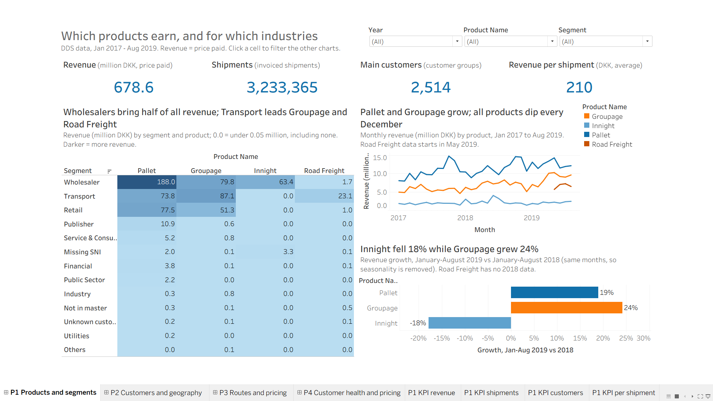

# Visual Analytics for PostNord Logistics and Lecture-Video Engagement

Tableau Prep workflows and Tableau dashboards built on 3.2 million logistics shipments (PostNord Logistics Denmark, DDS system) and 8,968 lecture-video viewing records. Course project in **MB221 Advanced Visual Analytics**, MSc in Information Systems, Kristiania University College.

**Project period:** September – November 2026



## What it does

| Part | Audience | Dashboards |
|---|---|---|
| PostNord sales | Sales and product managers | **P1** Products and segments · **P2** Customers and geography · **P3** Routes and pricing · **P4** Customer health and pricing |
| Lecture videos | Course manager and teachers | **V1** Content performance · **V2** Programmes and timing |

- **Data preparation (Tableau Prep):** a wildcard union of 100 monthly Excel files; removal of 1,504 rows duplicated across files; text-to-number conversions; repair of broken Danish characters in the master data; left joins to the customer and postcode masters; aggregation to a monthly grain (3.2 M → 930,757 rows with every total unchanged).
- **Dashboards (Tableau Desktop):** KPI tiles, a segment × product highlight table, a route ranking, a graduated-symbol delivery map, customer-status analysis, and a weekday × hour heatmap. They use a colour-blind-safe palette set once in the data source, and every dashboard has click-to-filter actions.
- **Data quality decisions:** zeros are shown as 0, while genuinely missing data is left as a gap and explained in the chart. All axes are linear. No forecast is shown, because 32 months of history is too short to forecast reliably.

## Selected findings

- Wholesale, Transport and Retail bring 95% of revenue; the top 10 customers bring 48%.
- Innight fell 18% (Jan–Aug 2019 vs 2018), almost entirely from one account, while Groupage grew 24% and Pallet 19%.
- Shipments to Sweden earn 876 DKK each, against 174 DKK within Denmark. Syddanmark → Sweden is the most valuable route.
- Growth comes from existing customers, even though the number of active customers is falling.
- Lecture videos: viewing drops from 397 to 21 students across the pre-recorded series, and 52% of views of live recordings last under one minute.

The full analysis is in [`report/MB221_Report_portfolio.pdf`](report/MB221_Report_portfolio.pdf).

## Repository structure

```
report/          final report (PDF)
dashboards/      screenshots of the six dashboards
prep_flows/      Tableau Prep flows PRP0001-PRP0004 (.tfl) and screenshots of each flow
design/          hand-drawn sketches, the marked-up evaluation of version 1, and the data lineage diagram
scripts/         Python: builds the Prep flows and Tableau workbooks, plus independent checks of every headline number
```

## Data

**The data is not included.** The PostNord DDS files and the lecture-viewing dataset were provided for the course and are not mine to publish. The same applies to the packaged workbooks (`.twbx`), which embed the data as extracts. The flows and scripts show the full method; to run them, point their input paths at a copy of the course data.

## Tools

Tableau Prep Builder 2026.3 · Tableau Desktop 2026.3 · Python (pandas, tableauhyperapi, matplotlib) · APA 7 reporting
